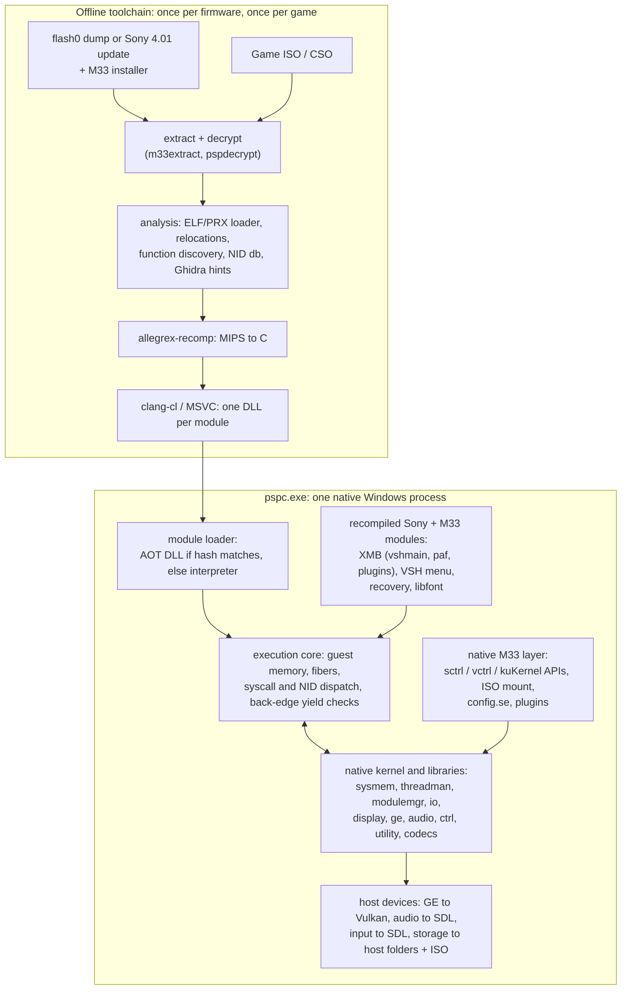

# PSPC: Plan for running PSP 4.01 M33 natively on Windows

**Goal:** Decompile the PSP 4.01 M33 firmware and rebuild it as a native Windows program that can launch and fully play PSP games.

**Status:** Planning. Written 2026-10-09 from a survey of this folder and of current PSP tooling.

---

## 1. What we have, and what the goal really requires

### 1.1 What is in this folder

| Resource | What it actually is | How we will use it |
|---|---|---|
| `401M33/UPDATE/EBOOT.PBP` | The M33 **installer**, not the firmware. `DATA.PSP` is a plain (unencrypted) 487 KB ELF. `DATA.PSAR` is **empty**. It expects Sony's official 4.01 update as `401.PBP`, or downloads it. | It contains **11 M33 modules**, each a `~PSP` header followed by gzip. Test-decompressing all 11 gave valid unencrypted PRX files (`e_type 0xFFA0`): `SystemControl` (two copies, PSP-1000 and PSP-2000), `VshControl`, `VshCtrlSatelite` (the VSH menu), `Recovery mode`, `M33GalaxyController`, `pspMarch33_Driver`, `M33IdCanager_Driver`, `M33PopcornManager`, `pspUsbDev_Driver` and `pspIplUpdate`. |
| `401M33/SDK` | The M33 SDK: headers and stub libraries for `sctrl*`, `vctrl*` and `kuKernel*`, plus `psp-packer` (its source documents the `~PSP` + gzip format) and the `bootload` sample (prebuilt ELF/PRX **with source code**). | API surface of M33 that we must reproduce. The `bootload` sample and `rdriver.prx` are our **first recompiler test inputs**, because we have their source to compare against. |
| `pspdecompiler/` | Humberto Naves' C89 PRX decompiler from about 2009. It has a complete Allegrex + VFPU **decode table**, PRX/relocation parsing, CFG, SSA and structuring. Per its TODO it has **no FPU/VFPU semantics, no type recovery and no reliable argument detection**, and its output is pseudo-C that cannot be recompiled. The `libexpat` submodule is not checked out. It ships a VS project. License: AFL-2.0. | We will **not** use it as the primary decompiler. We will use it as a cross-check for our decoder and PRX/relocation loader, for quick `-i` module info and for CFG/graphviz dumps. It stays a separate tool, because AFL-2.0 is GPL-incompatible. |
| `AnyPS5/` | A PS5→Windows/Linux **relinker** (GPL-2.0-only, actively developed, last commit 2026-10-10). The PS5 is x86-64, so game code runs **unchanged** and only system libraries are replaced. Submodules (SDL2, Vulkan, FFmpeg, glslang, …) are not checked out. | **The CPU trick does not transfer**, because the PSP is MIPS. The architecture and host code do transfer: system libraries reimplemented natively and keyed by NID, an import audit, progress tracking, SDL2 window/input/audio, Vulkan presentation, FFmpeg/FreeType integration, the "unimplemented means loud error" policy, and test conventions. |

**Host machine:** i7-13650HX (14 cores), 16 GB RAM, RTX 4060 Laptop (Vulkan), Windows 11. Installed: CMake, Git and Visual Studio 2022 Community. **Missing:** a real Python 3 (only the Microsoft Store stub is present), Ninja, LLVM/clang, a JDK, Ghidra and Graphviz.

### 1.2 Facts that shape the design

1. **Sony's 4.01 firmware is not in this folder.** M33 is a set of about 11 patch modules on top of roughly 100+ Sony modules in `flash0`: the kernel, drivers, codecs, the XMB, fonts and resources. We need a dump of your own PSP's flash0 or the official Sony 4.01 update, and then decryption (see Phase 1).
2. **Games are MIPS code too.** Decompiling and recompiling the OS alone does not run a single game. Every game's code (`EBOOT.BIN` and its PRXs) also needs a way to execute on x86. The plan treats **game code and firmware code with the same tool**: an Allegrex→C static recompiler, with an interpreter as a fallback.
3. **Some firmware cannot run as recompiled code.** Thread context switching, interrupts, exception vectors and loading code at runtime (threadman, interruptman, loadcore, modulemgr) work by manipulating CPU state. Once code is translated to C, the host owns the call stack and those mechanisms disappear. These modules must be **reimplemented natively**, using their decompilation as the specification.
4. **M33 works by patching Sony's MIPS code in RAM.** `systemctrl` rewrites instruction words in loadcore, modulemgr, the security modules and others. Those patches mean nothing once the code is recompiled. M33 behavior therefore has to be **reproduced natively** (most of it, such as "no signature checks", comes for free) or applied to the images before recompiling.
5. **Hardware with no public documentation must be emulated at the API level.** The Media Engine's codec hardware (VME), the GE's exact behavior and KIRK crypto are handled at the library boundary (`sceAtrac`, `sceMpeg`, `sceGe`, …), not at the register level.
6. **Prior art exists, but it is early.** Several PSP static recompilers appeared in 2025–2026: [psprecomp](https://github.com/sp00nznet/psprecomp) (MIT; per its README no retail game renders yet and there is no thread scheduler), [PSPRecomp](https://github.com/LiinkPK/PSPRecomp) (MIT; per-game profiles, GTA VCS first), [sal063/PSP-recompilation-project](https://github.com/sal063/PSP-recompilation-project) (GPL-2.0+, Vulkan, ports parts of PPSSPP) and [p3-recompiled-and-remastered](https://github.com/Montick1560/p3-recompiled-and-remastered) (GPL-2.0+, Patapon title screen). **None of them runs the firmware, and none is a general game launcher.** They are sources of components and lessons, not a base to fork blindly. [PPSSPP](https://github.com/hrydgard/ppsspp) already plays nearly every PSP game on Windows through emulation. This project differs by **running the real 4.01 M33 code natively** and **compiling game code ahead of time**. PPSSPP is our most important correctness oracle.

### 1.3 The resulting strategy

> **Recompile what is pure software; reimplement natively what touches hardware or CPU state. Use the decompiled firmware as the specification for everything we reimplement.**

- A single **Allegrex→C static recompiler** turns firmware modules (once per firmware) and game modules (once per game) into Windows DLLs.
- A **native runtime** provides guest memory, PSP threads on host fibers, the syscall/NID dispatch, a native kernel, native hardware-facing libraries (GE→Vulkan, audio, input, storage) and a native M33 layer.
- Sony's and M33's **user-level and VSH modules** run as recompiled code: the XMB, the VSH menu, recovery, libfont and others.
- An **interpreter** sharing the recompiler's instruction semantics covers anything the static pass missed.

"Decompilation" therefore means two things in this plan:

1. **Mechanical recompilation** (MIPS→C) for execution.
2. **Ghidra decompilation** for understanding, which produces specification documents for the native reimplementations.

A full hand-written "matching" decompilation of the firmware, in the style of the SM64 decomp, is **not** required, and it would cost years.

---

## 2. Target architecture



### 2.1 Policy for each firmware module

| Layer | 4.01 modules (examples) | Policy | Reason |
|---|---|---|---|
| Boot | IPL, `pspbt*nf.bin`, `init.prx` | Not executed | We start from a post-boot state. The boot configs are parsed only to learn the module list. |
| Kernel core | `sysmem`, `loadcore`, `modulemgr`, `loadexec`, `threadman`, `interruptman`, `exceptionman`, `systimer` | **Native** | They own CPU state, context switches and code loading (fact 3). |
| Hardware drivers | `ge`, `display`, `dmacman`, `audio`, `codec`, `ctrl`, `syscon`, `power`, `clockgen`, `led`, `hprm`, `rtc`, `lowio`, `dve` | **Native** | They drive MMIO. We provide equivalent behavior at the API level. |
| Storage | `iofilemgr`, `lflash`/`lfatfs`/`fatmsmod`/`msstor`, `umdman`, `isofs`, `mediaman`, `umdcache` | **Native** | `ms0:` maps to a host folder, `disc0:`/`umd0:` to an ISO/CSO, and `flash0:` to the decrypted dump. |
| Security | `memlmd`, `mesg_led`, `chkreg`, `openpsid`, `idstorage`, `npdrm`, `amctrl`, `semawm` | **Native or dropped** | Decryption happens offline, and signature checks are irrelevant (removing them is M33's purpose anyway). |
| Media Engine + codecs | `me_wrapper`, `avcodec`, `audiocodec`, `videocodec`, `mpegbase`, `sc_sascore`, `libatrac3plus`, `mpeg`, `libmp3`, `psmf` | **Native** (FFmpeg + native SAS mixer) | The ME's VME hardware is undocumented. |
| Network / USB | `wlan`, `pspnet*`, `usb*`, `usbstor*` | Stub, later ad-hoc over UDP | Not needed to play offline. |
| Pure-software user libs | `libfont_hv`, `libhttp`/`ssl`, `usersystemlib`, `sysclib`; later `utility` dialogs | **Recompile** (native fallback) | Gives exact Sony behavior for free. |
| VSH / XMB | `vshmain`, `paf`, `common_gui`, `common_util`, `*_plugin`; `vshbridge` is native | **Recompile** (Phase 8) | Gives the real 4.01 XMB. |
| M33 core | `systemctrl(_02g)`, `vshctrl`, `galaxy`, `march33`, `idcanager`, `popcorn`, `usbdevice` | **Native, from their decompilation** | They work by patching Sony code (fact 4). |
| M33 UI | `satelite` (VSH menu), `recovery` | **Recompile** | Pure UI on top of the `vctrl`/`sctrl` APIs we provide natively. |
| PS1 (POPS) | `popsman`, `pops`, M33 `popcorn` | Stretch goal | `pops` is itself an emulator. |

---

## 3. Phases

Sizes assume one dedicated developer with AI assistance: **S** = days, **M** = 1–4 weeks, **L** = 1–3 months, **XL** = 3+ months. These are rough. The **critical path** is 0 → 1 → 3 → 4 → 5/6 → 7. Phase 2 runs in parallel throughout.

### Phase 0: Groundwork (S)

- [ ] Install a real Python 3.12+ and disable the Store alias. Install Ninja, LLVM/clang (clang-cl), JDK 21, Ghidra 11.x with [ghidra-allegrex](https://github.com/kotcrab/ghidra-allegrex), and Graphviz. Confirm that the VS2022 "Desktop development with C++" workload is installed.
- [ ] `git init` this workspace. Add a `.gitignore` that excludes `private/`, which will hold firmware, decrypted modules, games and caches.
- [ ] Initialise `pspdecompiler`'s `libexpat` submodule. Build it with the VS project. Run `pspdecompiler -i -c` on `401M33/SDK/samples/bootload/bootload.prx`.
- [ ] Clone the reference projects into `third_party/` or `reference/`: [pspautotests](https://github.com/hrydgard/pspautotests), [pspsdk](https://github.com/pspdev/pspsdk), [uOFW](https://github.com/uofw/uofw), [pspdecrypt](https://github.com/John-K/pspdecrypt), [N64Recomp](https://github.com/N64Recomp/N64Recomp), [rabbitizer](https://github.com/Decompollaborate/rabbitizer), PPSSPP (build `PPSSPPHeadless`), and the PSP recompilers listed in §1.2.
- [ ] Spend one to two days per recompiler project evaluating it. Record in `docs/prior-art.md`: what builds, what runs, code quality, license, and which pieces we can reuse (decoder, VFPU semantics, KIRK, GE notes).
- [ ] **Decide the license posture (§7)** before any code is copied in.

**Exit:** toolchain works, pspdecompiler builds on Windows, and `docs/prior-art.md` is written.

### Phase 1: Acquire, extract and inventory the firmware (M)

- [ ] **1a. `tools/m33extract`:** scan the installer's `DATA.PSP` for `~PSP` headers and gunzip the payload at +0x150. Use `psp-packer/src/main.c` as the format specification. Write the 11 PRX files to `private/fw/401/m33/` (this has already been proven to work, §1.1).
- [ ] **1b. Sony 4.01 modules.** Choose one source:
  - **Preferred:** your own PSP on 4.01 M33. Use Recovery → Advanced → Toggle USB (flash0/flash1) to copy flash0 and flash1 to the PC. The PRX files are still KIRK-encrypted, so decrypt them with `pspdecrypt`.
  - **Alternative:** the official Sony 4.01 update file (the `401.PBP` the installer expects). `pspdecrypt` unpacks the PSAR and decrypts every module and resource.
  - In both cases, also keep the non-code assets: `flash0:/font/*.pgf`, `flash0:/vsh/resource/*.rco`, `flash0:/data/*` and the flash1 registry files.
- [ ] **1c. Pick a hardware model.** PSP-1000 has 32 MB, PSP-2000 has 64 MB and uses the `_02g` modules. Recommendation: **PSP-2000**, the last model 4.01 supported. Keep the memory map configurable.
- [ ] **1d. `tools/fwinventory`:** produce `private/fw/401/inventory.json` with, per module: name, path, kernel/user/VSH attribute, version, segments, imports and exports (library + NID), relocation types and SHA-1. Also generate a dependency graph (Graphviz) and an "imports by NID" table.

**Exit:** every 4.01 module plus the M33 modules are decrypted and listed in `inventory.json`, and the dependency graph renders.

### Phase 2: Analysis knowledge base (L, ongoing)

- [ ] **NID database** (`kb/nids/`):
  - User-library NIDs are the first 4 bytes of `SHA-1(name)`, read little-endian. Generate candidates from names in pspsdk, PPSSPP's HLE tables, uOFW headers and prxtool `psplibdoc` XMLs. Port the idea of AnyPS5's `NidCompute`/`nid_names.py`, swapping in the PSP formula.
  - Kernel-library NIDs differ between firmware versions. `systemctrl`'s NID-resolver tables map known NIDs to their 4.01 values, so extract them.
  - Outputs: `psplibdoc` XML (consumed by pspdecompiler and Ghidra scripts) and `nids.json`.
- [ ] **Ghidra project** containing every 4.01 and M33 module, with imports and exports named from the NID database and types applied from the pspsdk and M33 SDK headers. Add a headless export script that writes, per module, function boundaries, call graph, jump tables and pointer xrefs to JSON. **The recompiler consumes this as hints.**
- [ ] **Specification documents** (`private/specs/<module>.md`) for every module we reimplement natively: exports, structure layouts, error codes, edge cases, blocking and wake behavior, and interrupt interactions. Order the work by **how many of your games import each function** (from the import audit in Phase 4).
- [ ] **M33 behavior catalogue** (`docs/m33-behaviors.md`), written from decompiling `systemctrl`, `vshctrl`, `galaxy` and `march33`. Cover:
  - every patch and what it achieves
  - config.se fields
  - ISO modes (normal, M33 driver, Sony NP9660)
  - plugin loading (`seplugins/game.txt`, `vsh.txt`, `pops.txt`)
  - LoadExec variants
  - version and model spoofing
  - the NID resolver

**Exit:** NIDs are named for every import and export used by the firmware and by three or more reference games, and specs are written for the Phase 4 kernel modules.

### Phase 3: Allegrex recompiler and interpreter (XL, critical path)

**Loader.** Handle ELF and PRX (`0xFFA0`) files: standard MIPS relocations (`32`, `26`, `HI16`/`LO16`) and the PSP-specific type-A (`SHT 0x700000A0`) and type-B (`PT 0x700000A1`) relocations. Parse module info, import stubs and export tables.

**Function discovery.** Collect candidates from several sources:
- the entry point, `module_start`/`module_stop` and exports
- `jal` targets
- text addresses referenced by relocations (function pointers)
- jump-table patterns
- Ghidra hints
- per-module TOML overrides, in the style of N64Recomp

**Decoder.** Use rabbitizer's Allegrex mode or write our own. Cross-check it against `pspdecompiler/allegrex.c` and the psprecomp decode tests on every 32-bit encoding.

**Single source of instruction semantics.** One table or macro set generates **both** the interpreter and the C emitter, so the two cannot diverge.

**Code generation** (one C function per guest function):
- `ctx` holds the GPRs, HI/LO, FPU registers and flags, the 128 VFPU registers and the prefix state.
- Delay slots and "likely" branches are emitted inline.
- `jal` becomes a direct C call, and `jr $ra` becomes `return`.
- `jalr` and unresolved `jr` go through `dispatch(ctx, addr)`, a hash lookup that falls back to the interpreter.
- Tail jumps into other functions become tail calls. Functions with multiple entry points are split.
- `syscall` and import stubs become NID-resolved host calls.
- Relocatable PRX code computes `HI16`/`LO16` addresses from the module base at runtime, so modules can load anywhere (the technique N64Recomp uses for overlays).
- Backward branches decrement a budget counter and call `yield_check()`. That is where interrupts and preemption are delivered.

**VFPU in C with SSE/AVX:**
- the row, column and matrix register views
- `vpfxs`, `vpfxt` and `vpfxd` prefixes, tracked statically within a block
- `vcmp`/`vcmov`
- conversions
- bit-exact `vsin`/`vcos`/`vrsq`/`vexp2`, validated against hardware results from pspautotests

**FPU details:** single precision only, rounding and flush behavior, `cvt.w.s` saturation, and NaN handling.

**Memory accesses** use a fast path: a host base pointer plus the guest address masked by `0x3FFFFFFF`. MMIO goes through a slow path (see Phase 4).

**Tests:**
- `pspautotests` `cpu/*` and `vfpu/*`: recompile each test, run it, and diff against its `.expected` file.
- Lockstep differential runs: interpreter against recompiled code, comparing `ctx` at function boundaries.
- Random-instruction fuzzing, with PPSSPP's interpreter as ground truth.

**Exit:** 100% of `cpu/*` passes, at least 95% of `vfpu/*` passes with every exception documented, and the M33 SDK `bootload` sample recompiles and links.

### Phase 4: Runtime core and native kernel (XL)

**Guest memory:**
- Reserve 1 GB of host address space. Map scratchpad (16 KB at `0x00010000`), VRAM (2 MB at `0x04000000`, with mirrors) and RAM (`0x08000000`, 32 or 64 MB).
- Implement the `0x4…`, `0x8…` and `0xA…` segment mirrors as zero-cost views with `VirtualAlloc2` + `MapViewOfFile3` placeholders.
- Leave the MMIO range (`0xBC000000`–`0xBFFFFFFF`) unmapped. Accesses there go to device handlers, via static detection in the recompiler or a vectored-exception fallback.

**Threads:**
- Each PSP thread has a **guest stack** in guest RAM, allocated by our sysmem exactly as the PSP would, and a **host fiber** for the recompiled C call frames.
- All guest threads run on **one host thread**, which keeps scheduling deterministic, as in PPSSPP.
- Follow threadman's decompiled strict-priority rules: wait queues, callbacks (CB-enabled waits, `sceKernelCheckCallback`), delays, alarms, VTimers, and interrupts such as VBlank at 59.94 Hz. Interrupts are delivered at syscalls and back-edge yield points.

**Syscall and NID dispatch:**
- Declare each native function with a macro that takes the NID and a typed signature. Arguments are marshalled automatically from PSP EABI registers `a0`–`a3` and `t0`–`t3`.
- Unimplemented functions **log loudly and fail**, following AnyPS5's convention.
- Port AnyPS5's `import_audit.py` and `progress.py` ideas so we can see, for each game, which imports are implemented, stubbed or missing.

**Native libraries (first wave):** `ThreadManForUser`, `SysMemUserForUser`, `ModuleMgrForUser` (loads AOT DLLs or falls back to the interpreter), `LoadExecForUser`, `IoFileMgrForUser` (devices `ms0:`, `disc0:`/`umd0:`, `flash0:`, `host0:`), `StdioForUser`, `UtilsForUser`, `Kernel_Library`, `InterruptManager`, `sceSuspendForUser`, `sceRtc`, `scePower`, `sceDisplay` (framebuffer to window), `sceCtrl`, `sceUmdUser`, `sceImpose`, `sceReg` and `sceDmac`.

**Host layer:** an SDL2 window and input layer, an audio device and a Vulkan swapchain. Reuse AnyPS5's `libSceVideoOut`, `libScePad`/InputMapping and `libSceAudioOut` code where the license allows.

**Exit (milestone "Hello PSP"):** pspsdk console and framebuffer samples and the M33 `bootload` sample run in a Windows window. `pspautotests` `threads/`, `sysmem/`, `io/`, `modules/`, `rtc/` and `ctrl/` pass.

### Phase 5: Graphics: GE to Vulkan (XL)

**GE device:**
- Display-list processing: `sceGeListEnQueue`/`Sync`, stall addresses, signals and the FINISH and SIGNAL interrupts, running on its own host thread.
- Decoding of the 32-bit command stream (8-bit opcode, 24-bit argument).

**Vertex pipeline:**
- every vertex format, morph weights, 8-bone skinning, and Bezier/spline tessellation
- fixed-function transform and lighting (4 lights, material, fog)
- pipelines generated from GE state as GLSL, compiled to SPIR-V with glslang (already an AnyPS5 submodule)

**Textures:**
- formats 5650, 5551, 4444 and 8888; CLUT4, CLUT8, CLUT16 and CLUT32; DXT1, DXT3 and DXT5; swizzled layouts
- a texture cache invalidated by tracking guest writes (`GetWriteWatch` or hashing)

**Framebuffers:** render-to-texture, depth buffers, block transfers, CPU readback of VRAM, and optional upscaling.

**Build vs. adapt:** adapting [PPSSPP's GPU code](https://github.com/hrydgard/ppsspp/tree/master/GPU) (GPL-2.0+) is the single biggest shortcut to "fully playable". Writing our own GE backend means years to reach parity. This choice is tied to the license decision (§7).

**Exit (milestone "First 3D"):** `pspautotests` `gpu/` passes. A pixel-diff harness against PPSSPP passes on pspsdk `gu/*` samples.

### Phase 6: Audio and media (L)

- `sceAudio`: channels, output2 and sample-rate conversion.
- `sceSas`: 32-voice mixer with VAG ADPCM, ADSR envelopes, pitch, reverb presets and ATRAC voices.
- `sceAtrac3plus`: ATRAC3 and ATRAC3+ through FFmpeg, including its stateful streaming and loop API.
- `sceMp3`, `sceAac`, `sceAudiocodec`.
- `sceMpeg`, `scePsmf`, `scePsmfPlayer` and `sceVideocodec`: H.264 and ATRAC3+ demuxing through FFmpeg.
- Check that the FFmpeg build includes the `atrac3`, `atrac3p` and `h264` decoders.

**Exit:** `pspautotests` `audio/` passes, game intro movies play, and music and sound effects play in sync.

### Phase 7: Game pipeline and launcher (L)

**Containers:** ISO and CSO (CISO v1; later ZSO). PSN `EBOOT.PBP`/NPDRM titles are deferred, because they need license files from your own console.

**Decryption:** decrypt `EBOOT.BIN` and the PRXs offline with software KIRK (libkirk / pspdecrypt), covering every tag those tools support.

**AOT build (`pspc-build <game.iso>`):**
1. Find every ELF/PRX on the disc.
2. Decrypt each one.
3. Analyse and generate C.
4. Compile in parallel (14 cores) into `private/cache/<DISC_ID>/<sha1>.dll`.

The target for this first-launch build is under 5 minutes.

**At runtime:**
- `sceKernelLoadModule` maps a module to its DLL by the SHA-1 of the decrypted image.
- Anything not covered (code loaded from a memory buffer, generated or self-modifying code, missed indirect targets) runs in the **interpreter**. Every newly discovered entry point is logged to `hints.json`, and the next build includes it (a coverage feedback loop).
- Guest writes to text pages invalidate the affected code and drop it to the interpreter.

**Compiler at runtime:** during development, use your local MSVC or clang. A distributable build would bundle clang. A direct x86-64 emitter is a later option.

**Launcher:** a native window (SDL2 + Dear ImGui) with a game grid built from `PARAM.SFO`, `ICON0` and `PIC1`, settings, controller mapping, and save data under `ms0/PSP/SAVEDATA`.

**Exit (milestone "First game"):** three reference games you own are playable start to finish. Pick one that is 2D, one that is heavy on 3D and VFPU, and one that is heavy on FMV and ATRAC.

### Phase 8: The real 4.01 M33 OS layer (XL)

**Firmware install step.** `pspc-install-fw <flash0 dump>` decrypts and AOT-recompiles every VSH and user module once, into `private/fw/401/aot/`.

**Booting the XMB.** Start from a post-reboot state with our native kernel, then load the VSH modules as recompiled code:
- `vshmain`, `paf`, `common_gui`/`common_util`, and the plugins (game, sysconf, video, music, photo, …)
- `vshbridge` stays native

The XMB also needs a registry backed by flash1, `.pgf` fonts through recompiled `libfont`, `.rco` resources, battery/clock/Wi-Fi status reporting, and `sceUtility`.

**Native M33 APIs.** Implement the `sctrl*`, `vctrl*` and `kuKernel*` exports from the M33 SDK headers, following `docs/m33-behaviors.md`:
- `config.se` settings
- `sctrlSEMountUmdFromFile`, routed to our ISO backend
- the `sctrlKernelLoadExecVSH*` family, routed to the game launcher
- plugin lists, with `sctrlHENPatchSyscall`, `sctrlHENSetStartModuleHandler` and `sctrlHENFindFunction` supported by making our dispatcher patchable

**M33 UI.** The VSH menu (`satelite.prx`, opened with SELECT) and `recovery.prx` run as recompiled code on top of those APIs.

**Launch and exit flow.** XMB → Game → Memory Stick (ISO folder) → launch tears down the VSH "process" and boots the game's AOT bundle, like a real reboot. HOME → Quit returns to the XMB.

**Exit (milestone "XMB on Windows"):** the real 4.01 M33 XMB boots, browses ISOs, launches a game and returns to the XMB afterwards. The VSH menu and recovery work.

**Status (2026-10-10), details in [docs/vsh-boot.md](docs/vsh-boot.md):**
- [x] Install step: `tools/pspc_install_fw.py` copies flash0 (vsh, font, dic, data, kd), M33's satelite/recovery, prepares flash1, AOT-compiles the user-mode firmware modules.
- [x] `pspc --vsh` and the launcher's "Boot XMB": the real 4.01 XMB boots (opening logo, wave, icons) with vshmain/paf/common_*/plugins as AOT code and every kernel module native; `vshbridge` is native (`sceVshBridge` forwarding table), `index.dat` decrypts through pspc-decrypt.
- [x] Navigation with scripted input through every category and into Settings submenus.
- [x] ISOs in `ms0:/ISO` under Game > Memory Stick (native vshctrl overlay), launching one restarts pspc with it, the game's exit (or HOME) returns to the XMB.
- [x] VSH menu (`satelite.prx`, SELECT) and recovery (`--recovery` or R at boot).
- [x] Registry writes of the XMB persist in `flash1:/registry/pspc.reg`.
- [ ] Remaining: a PSP-style HOME screen in games (now a host message box), GAME150/GAME4XX and video ISOs, `sceUtility_private`/`sceChnnlsv` (copying saves)/network pieces the plugins import (not on the boot path), ID storage (System Information), clock setting.

### Phase 9: Compatibility, performance and polish (ongoing)

- **Compatibility:** a compatibility list (like AnyPS5's `COMPATIBILITY.md`), per-game hint files and crash reports that include the guest PC and a backtrace.
- **Performance:** profile the generated code. Keep registers in C locals across blocks, use SIMD for the VFPU and enable LTO. The target is full speed on the i7-13650HX with headroom.
- **Stretch goals:**
  - ad-hoc multiplayer over UDP (PPSSPP-compatible)
  - running POPS (`pops.prx`) recompiled for PS1 titles
  - user-mode game plugins (CWCheat-style) through M33's plugin path
  - save states (hard with native fibers; may be limited to "suspend at VBlank")

---

## 4. Verification strategy

Correctness is decided by oracles. In descending order of authority:

1. **A real PSP**, if you have one on 4.01 M33. Run pspautotests and custom probes through PSPLink + usbhostfs, and capture text output and framebuffers. This mirrors AnyPS5's `tools/hw-oracle` idea.
2. **PPSSPP headless**, which runs pspautotests against `.expected` files. We also use it for frame dumps when pixel-diffing the GE.
3. **Our own interpreter**, in lockstep with recompiled code, to find recompiler bugs automatically.

The test layers are:

| Layer | Test | Where it runs |
|---|---|---|
| Decoder | Every 32-bit word decoded and cross-checked against pspdecompiler and rabbitizer | CI |
| Recompiler | pspautotests `cpu/` and `vfpu/`; fuzzing; lockstep differential | CI (homebrew only) |
| Kernel | pspautotests `threads/`, `sysmem/`, `io/`, `modules/`, … | CI |
| GE | Display-list replays pixel-diffed against PPSSPP | CI with homebrew lists; locally with game lists |
| Firmware and games | Boot-to-title, scripted input runs, an import-audit report | **Local only**, because they use copyrighted inputs |

CI runs on GitHub Actions on Windows. No firmware, keys, decrypted modules or game data ever go into the repository or CI.

---

## 5. Proposed repository layout

```
PSPC/
  PLAN.md
  docs/            architecture.md, prior-art.md, m33-behaviors.md, conventions.md
  reference/       401M33/, pspdecompiler/, AnyPS5/ (moved here, read-only)
  tools/           m33extract, fwinventory, nidgen, ghidra-scripts/, import_audit, progress
  recomp/          decoder/, loader/, analysis/, semantics/, codegen/, interp/
  runtime/
    core/          memory, fibers + scheduler, dispatch, module loader
    hle/           one folder per PSP library (ThreadManForUser/, IoFileMgrForUser/, sceGe_user/, ...)
    devices/       ge/, audio/, input/, storage/
    m33/           systemctrl/vshctrl/kubridge native APIs
    host/          SDL2, Vulkan, FFmpeg glue
  frontend/        launcher UI
  tests/           unit/, autotests/, differential/, gpu-diff/
  third_party/     submodules (SDL2, Vulkan-Headers, glslang, ffmpeg, rabbitizer, pspautotests, ...)
  private/         gitignored: fw/401/, specs/, games/, cache/
```

---

## 6. Risks and mitigations

| Risk | Impact | Mitigation |
|---|---|---|
| Firmware not obtainable or not decryptable | Blocks Phases 1, 2 and 8 | Dump your own PSP; pspdecrypt supports 4.01-era tags. Phases 3–7 can start with homebrew alone. |
| VFPU accuracy (prefixes, transcendental functions) | Broken 3D math in games, as reported by p3-recompiled-and-remastered | Bit-exact test vectors from hardware and pspautotests; lockstep against the interpreter |
| Incomplete static control-flow discovery | Crashes on indirect jumps | Interpreter fallback plus the `hints.json` coverage feedback loop, Ghidra hints and relocation-driven pointer discovery |
| Timing-sensitive games (busy-waits, VBlank races) | Hangs, wrong speed | Back-edge yield budget, idle-loop detection, accurate VBlank and timer interrupts |
| GE accuracy (framebuffer tricks, CLUT, depth) | Visual bugs on the long tail of games | Adapt PPSSPP's GPU code if the license allows; pixel-diff harness |
| Generated C is huge (millions of lines per big game) | Slow first launch | Many small translation units, parallel compile, caching, `-O1` by default; a direct x86 emitter later |
| Native fibers make save states hard | Missing feature | Accept for now; possibly snapshot only at safe points |
| Scope creep: the XMB before any game runs | Nothing playable for a long time | The XMB is Phase 8, after the native launcher plays games |
| License contamination | Can't publish | Decide in Phase 0 (§7). Keep incompatible tools external. |
| Games that need firmware newer than 4.01 | Missing NIDs or keys | Decryption is offline. Decide whether the native kernel stays strictly 4.01 or is extended (§8). |

---

## 7. Legal and licensing

**Copyrighted inputs stay private.** Sony firmware, decrypted modules, Ghidra databases of Sony code, specs that quote decompiled code, and game files are all copyrighted. They live only in the gitignored `private/` folder and are never published. Use dumps of your own PSP and your own UMDs.

**Clean-room separation.** If the code will ever be published, write native reimplementations from the spec documents in your own words, not by pasting decompiler output. uOFW and PPSSPP took the same stance.

**Third-party licenses:**

| Project | License | How it can be used |
|---|---|---|
| AnyPS5 | GPL-2.0-only | Reusing its code makes the combined work GPLv2 |
| PPSSPP | GPL-2.0-or-later | Compatible with GPLv2 |
| psprecomp, PSPRecomp | MIT | Can be reused in any license posture |
| uOFW | MIT | Can be reused in any license posture |
| N64Recomp | MIT | Can be reused in any license posture |
| rabbitizer | MIT (verify) | Can be reused in any license posture |
| ghidra-allegrex | Apache-2.0 | Tool only |
| pspdecrypt | GPL-3.0 | Run as an **external tool**; do not link it into a GPLv2-only project |
| pspdecompiler | AFL-2.0 | Incompatible with the GPL; keep it a separate tool |

**Recommendation:** license the project **GPL-2.0**. That allows reusing AnyPS5's host code and PPSSPP's GPU and media code, which is the fastest route to "fully playable". The alternative is **MIT with clean-room code** (build on psprecomp's components and use PPSSPP only as an oracle). It is slower but leaves the code freely licensable.

---

## 8. Decisions needed from you

1. **License posture:** GPL-2.0 with PPSSPP and AnyPS5 reuse (recommended), or permissive clean-room?
2. **Firmware source:** do you have a PSP running 4.01 M33? It is both the cleanest firmware source and the best hardware oracle. If not, use the official 4.01 update file.
3. **Target model:** PSP-2000 (recommended) or PSP-1000?
4. **Strict 4.01 or extended:** should the native kernel support NIDs from newer firmware, so that post-4.01 games also run?
5. **Reference games:** which three or more games do you own, so we can tune for them first? Ideally a 2D game, a 3D/VFPU-heavy game and an FMV/ATRAC-heavy game.
6. **Base:** build our own codebase while reusing components (recommended), or fork one of the existing PSP recompilers after the Phase 0 evaluation?

---

## 9. Next steps (first two weeks)

1. Install the missing toolchain (Phase 0) and `git init` the workspace with `private/` gitignored.
2. Build pspdecompiler on Windows and run it on the SDK `bootload.prx` / `rdriver.prx` samples.
3. Write `tools/m33extract` and commit it (the code, not its output). Extract the 11 M33 modules to `private/fw/401/m33/`.
4. Obtain and decrypt the Sony 4.01 modules (Phase 1b). Run `fwinventory`.
5. Set up the Ghidra project with ghidra-allegrex. Load `systemctrl` and `vshctrl` first and start `docs/m33-behaviors.md`.
6. Evaluate psprecomp, PSPRecomp, sal063 and p3-recompiled-and-remastered, and write `docs/prior-art.md`.
7. Clone pspautotests and get PPSSPP headless running it, so the oracle exists before the recompiler does.
8. Answer the decisions in §8.

---

## References

- AnyPS5 (in this folder): https://github.com/boykopovar/AnyPS5
- psprecomp: https://github.com/sp00nznet/psprecomp ([architecture](https://github.com/sp00nznet/psprecomp/blob/main/docs/ARCHITECTURE.md))
- PSPRecomp: https://github.com/LiinkPK/PSPRecomp
- PSP-recompilation-project: https://github.com/sal063/PSP-recompilation-project
- p3-recompiled-and-remastered: https://github.com/Montick1560/p3-recompiled-and-remastered
- uOFW: https://github.com/uofw/uofw
- ghidra-allegrex: https://github.com/kotcrab/ghidra-allegrex
- pspdecrypt: https://github.com/John-K/pspdecrypt
- N64Recomp: https://github.com/N64Recomp/N64Recomp
- pspautotests: https://github.com/hrydgard/pspautotests
- pspsdk: https://github.com/pspdev/pspsdk
- PPSSPP: https://github.com/hrydgard/ppsspp
