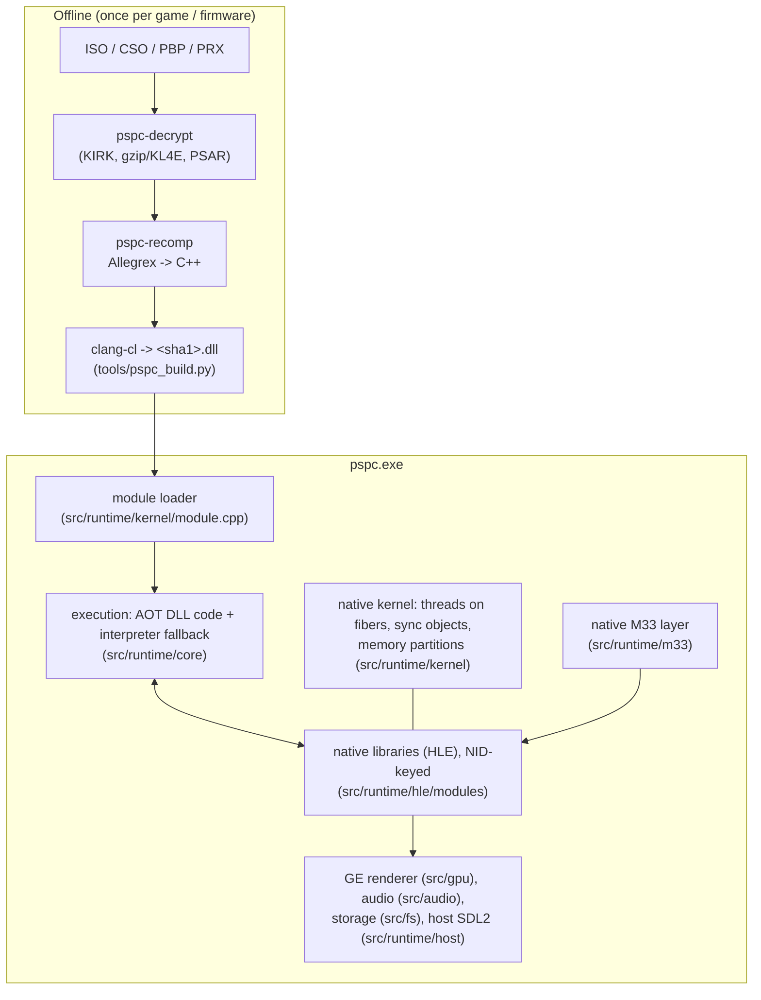

# Architecture

PSPC runs PSP software as a native Windows process. The design rule from [PLAN.md](../PLAN.md):

> Recompile what is pure software; reimplement natively what touches hardware or CPU state.
> Use the decompiled firmware as the specification for everything we reimplement.

## Source tree

| Path | What |
|---|---|
| `src/allegrex/` | Instruction list (`ops.inc`, `vfpu_ops.inc`), decoder, disassembler and the **shared semantics** (`sem.h`, `vfpu_sem.h`): one definition per instruction used by both the interpreter and generated code. `ctx.h` (guest CPU state) and `aot_abi.h` (runtime <-> DLL interface) are ABI. |
| `src/loader/` | ELF/PRX parsing, PSP relocations (type A and B), import/export tables, `~PSP` header. Shared by runtime and recompiler. |
| `src/recomp/` | `pspc-recomp`: module image, function discovery, C++ code generation. |
| `src/runtime/core/` | Guest memory (512 MB reservation, aliased mirrors), dispatch table (guest address -> native function), interpreter, CPU glue. |
| `src/runtime/kernel/` | Scheduler (guest threads = Windows fibers on one host thread), threads, callbacks, wait queues, memory partitions, module loading. |
| `src/runtime/hle/` | HLE framework (`hle.cpp`: syscall table, NID registry; `hle_wrap.h`: automatic PSP-EABI argument marshalling) and one file per library in `modules/`. |
| `src/runtime/io/`, `src/runtime/media/` | The PSP device namespace (`ms0:`, `host0:`, `flash0:`, `flash1:`, `disc0:`, `umd0:`, `emulator:`). |
| `src/runtime/m33/` | The M33 CFW behaviours (SystemCtrl, KUBridge, VshCtrl, config.se, plugins, NID resolver). |
| `src/fs/` | Disc images (ISO/CSO/ZSO/DAX), ISO9660, host file system, PBP, PARAM.SFO. |
| `src/gpu/` | GE display-list processing and software rasterizer. |
| `src/audio/` | Audio decoders and mixers (ATRAC3/3+, SAS, MP3...). |
| `tools/pspc-decrypt/` | Separate GPL-3.0 executable (uses libkirk). Never linked into `src/`. |
| `tools/*.py` | AOT build driver, autotest runner, firmware/M33 extraction and analysis, NID database generation, Ghidra pipeline. |

## Execution model

**Guest memory.** `g_membase` points at a 512 MB reservation; every PSP virtual segment folds onto
physical memory with `addr & 0x1FFFFFFF`. The scratchpad, VRAM (+3 mirrors) and RAM are views of
one page-file section, so mirrors alias for free. A stray access maps a shared zero page and is
logged (PPSSPP's "ignore bad accesses" default); `--strict-mem` makes it fatal.

**Two engines, one semantics.** For every non-control-flow instruction `X` there is
`sem_X(Ctx *c, u32 insn)` in `sem.h`/`vfpu_sem.h`. The interpreter calls it with the fetched word;
generated code calls it with the word as a literal, so the compiler folds the field decoding away.
Control flow (delay slots, likely branches, calls, returns) is implemented separately in the
interpreter and the code generator, against the conventions in `aot_abi.h`.

**Calls and returns.** Guest functions become C functions `void F_addr(Ctx *c)`. A `jal` inside a
module is a direct C call; anything else goes through `dispatch::Call`, which runs native code if
registered for that address and otherwise interprets. `jr $ra` returns when `$ra` still holds the
value it had on entry; otherwise (longjmp-style) a non-local return propagates up the C stack
(`c->unwinding`) until a frame whose call site matches. Unknown jump targets fall into the
interpreter, which calls back into native code whenever it reaches a registered function.

**Threads.** Each PSP thread is a Windows fiber with its own guest stack (in guest RAM, laid out
like the firmware does) and host stack. All fibers run on one host thread, which keeps scheduling
deterministic. A blocking HLE call (`sched::Wait`) switches to the scheduler fiber; strict
priority scheduling, callbacks, timeouts and interrupts (VBlank, alarms, GE) follow the PSP's
rules. Recompiled code yields at backward branches every 20 000 iterations so timer events and
interrupts are delivered.

**HLE.** Import stubs are rewritten to `jr ra; syscall CODE` and registered in the dispatch table;
`CODE` indexes a table of (library, NID) -> native function. Functions are declared with
`HLEFN(nid, fn)`; arguments are read from `$a0-$t3` / `$f12-` per the PSP EABI and results are
written to `$v0/$v1/$f0`. Unknown NIDs log once and return 0.

**Modules.** `kernel::LoadModuleFromMemory` classifies the file (plain ELF, M33 gzip-packed, KIRK
encrypted -> `pspc-decrypt`), allocates memory (keeping the low 16 bits of an AOT module's
recompile address so LO16-only relocations stay valid), relocates, binds imports (to other guest
modules' exports, else native), and loads `cache/aot/<sha1>.dll` when present.

## AOT DLLs

See [RECOMPILER.md](RECOMPILER.md). A DLL holds one module; the runtime matches it by the SHA-1 of
the decrypted ELF, sets its relocation delta and registers its functions in the dispatch table.

## What is native vs. recompiled

| Native (HLE) | Runs as guest code (recompiled or interpreted) |
|---|---|
| kernel (threads, sync, memory, modules, interrupts), I/O, display, controller, power, RTC, UMD | games, homebrew, game-shipped libraries (sceDeflt, sceMd5, sceHeap, sceCcc...) |
| GE graphics, audio output, SAS, ATRAC/MP3/MPEG codecs, network (offline) | M33 user-level UI (VSH menu, recovery) once firmware is present |
| sceUtility dialogs and save data | the 4.01 XMB (vshmain, paf, plugins) once firmware is present |
| M33 SystemCtrl/KUBridge/VshCtrl behaviours | M33 game plugins (`seplugins/game.txt`) |
